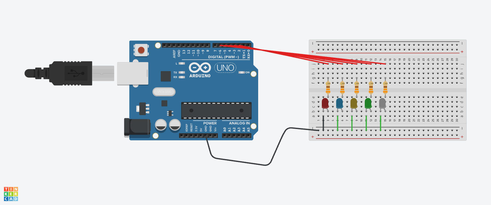

# Signals and Systems

> ** Remove the instructions in block quotes before you submit **

> Design, build, program, and test a signaling system that communicates useful information without a screen or speaker. The red, yellow, and green LEDs 
> automatically cycle through your planned states; no push button is needed. Complete this README as you work. Keep your planning, testing evidence, and 
> link to your video demo here.

## 1. System purpose

- **Problem and real-world context:** TODO
- **Intended user:** TODO
- **What information should your signals communicate?** TODO
- **How does the user interpret and use that information?** TODO

## 2. State table and pattern plan

> Use the launch activity's approach: interpret a pattern, identify its states, and explain its meaning. Plan at least three meaningful message states. A 
> message may use several rows, such as a blinking pattern.

> Record a new row whenever any LED changes. Use ON/OFF and durations in milliseconds (1,000 ms = 1 second). Add or remove rows as needed. The last row 
> returns to the first automatically.

| Step | State/message name | Red LED  | Blue LED | Green LED | Yellow LED | White LED | Duration (ms) | Meaning to the user |
| --- | --- | --- | --- | --- | --- | --- | --- | --- |
| 1 | Red light | ON | OFF | OFF | OFF | OFF | 20 - 600 | Red is selected |
| 2 | Blue light | OFF | ON | OFF | OFF | OFF | 20 - 600 | Blue is selected |
| 3 | Green light | OFF | OFF | ON | OFF | OFF | 20 - 600 | Green is selected |
| 4 | Yellow light | OFF | OFF | OFF | ON | OFF | 20 - 600 | Yellow is selected |
| 5 | White light | OFF | OFF | OFF | OFF | ON | 20 - 600 | White is selected |
| 5 | No light | OFF | OFF | OFF | OFF | OFF | 20 - 600 | The round is over, whichever light is blinking is the selected one |

**Sequence:** Red light → Blue light → Green light → Yellow light → White light → repeat until light time is long enough → End light → No light → repeat three times → End light 

## 3. Circuit design

### Ohm's law calculations

> Use `R = (V_output - V_LED) / I` to estimate the resistance for each LED. Use volts, amperes, and ohms; convert milliamperes to amperes. 
> . Choose a suitable available resistor and check the resulting current using `I = (V_output - V_LED) / R`.

| LED | Arduino output voltage (V) | LED voltage drop (V) | Calculated resistor voltage (V) | Target current (A) | Calculated resistance (Ω) | Chosen resistance (Ω) | Estimated actual current (A) |
| --- | --- | --- | --- | --- | --- | --- | --- |
| Red LED | 5.0 | 2v  |3v |10mA |300Ω|330Ω |  6mA |
| Blue LED | 5.0 | 3v  | 2v | 10mA |200Ω  | 220Ω  | 9mA |
| Green LED | 5.0 | 3v | 2v | 15mA |  133Ω | 220Ω| 9mA | 
| yellow LED | 5.0 | 2v | 3v | 15mA |200Ω  |  220Ω| 13mA | 
| White LED | 5.0 | 3v  | 2v  | 15mA |133Ω|  220Ω | 9mA |

## 4. Testing and revision
> Test your system with two people outside our class. Show each person the complete sequence before explaining its intended meaning. Ask:
> What do you think this system is communicating? Describe what each light pattern means to you.
> Were any patterns confusing or difficult to tell apart? Explain which ones and why.
> What would make the signals easier to understand? Consider the colors, combinations, blinking, or timing.

**Person 1:** TODO

**Person 2:** TODO

**Did their interpretations match your intended meaning? Explain:** TODO

**Revisions made to the system based on feedback**
> Describe at least one revisions you made based on the feedback you received and TEST it again.

**Revision and reason**: TODO

**Result after testing the revision:** TODO

## 5. Video Demonstration
> Replace the placeholder below with a link to your video. Demonstrate the complete repeating sequence and explain what each signal communicates. Make sure 
> your instructor can access the video.

[Video demonstration](https://youtube.com/)